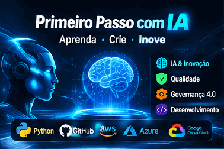

  

  
  
  
  
  

# Desafios Criativos de Inteligência Artificial

> **AI Engineer | Especialista em Governança 4.0 e Qualidade | Engenheiro Químico**  
> [Mauá, SP](mailto:ornelas.tozato@gmail.com) | [LinkedIn](https://www.linkedin.com/in/rafaeltozato81) | [GitHub](https://github.com/Rafael-TOZATO) | [Portfólio PWA](https://tozato-dev-hub.vercel.app) | [Medium](https://medium.com/@ornelas.tozato)

Repositório estruturado para armazenamento e versionamento dos desafios prácticos, projetos criativos e aplicações desenvolvidas ao longo da trilha de aprendizado e capacitação em Inteligência Artificial.

## Visão Geral do Repositório

Este espaço centraliza as soluções práticas e implementações desenvolvidas, aplicando conceitos de engenharia de prompt, automação e integração de modelos de IA para resolução de problemas reais.

## Tecnologias e Ferramentas

* **Inteligência Artificial:** Modelos de Linguagem, Automação de Processos e Prompts Estruturados
* **Versionamento:** Git e GitHub com fluxo de trabalho padronizado
* **Governança e Qualidade:** Boas práticas de desenvolvimento alinhadas aos padrões de mercado

**Rafael Ornelas Tozato**

Engenharia Química | Garantia da Qualidade | Governança 4.0

## 📬 CONTATOS E PERFIS

💻 **PROJECTS & PORTFOLIOS**
* App Ecosystem / Dev Hub: https://tozato-ai-core.vercel.app
* H-Folio Professional: https://h-folio-I0.vercel.app

🧩 **AGENSI**
* Creator: https://www.agensi.io/creators/rafael-ornelas-tozato

🐙 **CODES & REPOSITORIES**
* GitHub: https://github.com/Rafael-TOZATO

✍️ **ARTICLES & PUBLICATIONS**
* Medium: https://medium.com/@ornelas.tozato
* DEV Community: https://dev.to/rafaeltozato

🪟 **MICROSOFT LEARN**
* Perfil: https://learn.microsoft.com/pt-br/users/rafaelornelastozato-2209

💼 **LINKEDIN**
* Perfil Profissional: https://www.linkedin.com/in/rafaeltozato81

📬 **CONTACT**
* E-mail: ornelas.tozato@gmail.com
